# ERD - 4th Generation Town Dataset (Comprehensive Data Dictionary)

**Source:** `01_CLEAN_SOURCE_CSV/` (19 CSV files, 2025 data)  
**Cleaned Data:** `Code/data set/after process/` (duplicates removed, missing values imputed where logical)  
**Purpose:** Complete schema documentation with detailed descriptions of every table, column, and relationship for analysis and dashboard development.

## Table of Contents

- [Dataset Overview](#dataset-overview)
- [Complete Data Dictionary](#complete-data-dictionary)
- [Entity Relationships](#entity-relationships)
- [Enhanced Mermaid ERD](#enhanced-mermaid-erd)
- [Data Usage Guidelines](#data-usage-guidelines)

## Dataset Overview

| Table | Description | Records | Time Granularity | Primary Use Case |
|---|---|---|---|---|
| `air_quality` | Environmental monitoring data capturing air pollutant concentrations (PM2.5, PM10, NO2, O3) and meteorological conditions at air quality stations throughout the city. | 70,080 | Time-series (timestamp) | Environmental monitoring data capturing air pollutant concentrations (PM2 |
| `bin_fill` | Real-time smart waste bin monitoring data tracking fill levels and temperature to optimize collection routes and prevent overflow. | 1,314,000 | Time-series (timestamp) | Real-time smart waste bin monitoring data tracking fill levels and temperature to optimize collection routes and prevent overflow |
| `bms_readings` | Building Management System telemetry providing indoor environmental conditions, HVAC energy consumption, and occupancy data for managed buildings. | 219,000 | Time-series (timestamp) | Building Management System telemetry providing indoor environmental conditions, HVAC energy consumption, and occupancy data for managed buildings |
| `camera_status` | CCTV infrastructure health monitoring tracking camera uptime and operational status across the surveillance network. | 21,900 | Daily (date) | CCTV infrastructure health monitoring tracking camera uptime and operational status across the surveillance network |
| `collection_trips` | Waste collection operation records detailing truck routes, trip schedules, number of bins collected, and total waste tonnage. | 1,894 | Event-based (trip) | Waste collection operation records detailing truck routes, trip schedules, number of bins collected, and total waste tonnage |
| `electricity_meters` | Building-level electricity consumption readings for energy monitoring, billing, and load analysis. | 2,864,520 | Time-series (timestamp) | Building-level electricity consumption readings for energy monitoring, billing, and load analysis |
| `gov_services` | Aggregated government service delivery metrics tracking transaction volumes and processing times by service type and channel. | 4,380 | Daily (date) | Aggregated government service delivery metrics tracking transaction volumes and processing times by service type and channel |
| `incidents` | Security and public safety incident records including location (zone), type, severity, source, response times, and resolution status. | 23,960 | Time-series (timestamp) | Security and public safety incident records including location (zone), type, severity, source, response times, and resolution status |
| `network_pressure` | Water distribution network monitoring capturing pressure and flow rates at key sensor points to detect leaks and ensure service quality. | 700,348 | Time-series (timestamp) | Water distribution network monitoring capturing pressure and flow rates at key sensor points to detect leaks and ensure service quality |
| `noise` | Environmental noise level monitoring providing equivalent continuous sound levels across different city locations. | 87,600 | Time-series (timestamp) | Environmental noise level monitoring providing equivalent continuous sound levels across different city locations |
| `ops_tickets` | Centralized operations ticketing system tracking issues across city pillars with escalation workflows and resolution tracking. | 7,118 | Aggregated | Centralized operations ticketing system tracking issues across city pillars with escalation workflows and resolution tracking |
| `parking_occupancy` | Real-time parking lot occupancy monitoring showing capacity utilization across parking facilities. | 105,120 | Time-series (timestamp) | Real-time parking lot occupancy monitoring showing capacity utilization across parking facilities |
| `service_requests` | Citizen service requests (311 system) submitted via multiple channels with Arabic descriptions, tracking, and satisfaction ratings. | 44,817 | Aggregated | Citizen service requests (311 system) submitted via multiple channels with Arabic descriptions, tracking, and satisfaction ratings |
| `streetlights` | Street lighting infrastructure monitoring including operational status and daily burn hours for maintenance planning. | 146,000 | Daily (date) | Street lighting infrastructure monitoring including operational status and daily burn hours for maintenance planning |
| `traffic_counts` | Traffic flow monitoring capturing vehicle counts, average speeds, and road occupancy at sensor locations. | 1,435,612 | Time-series (timestamp) | Traffic flow monitoring capturing vehicle counts, average speeds, and road occupancy at sensor locations |
| `transit_ridership` | Public transportation ridership data showing boardings, alightings, and on-time performance by route and stop. | 8,030 | Daily (date) | Public transportation ridership data showing boardings, alightings, and on-time performance by route and stop |
| `water_meters` | Building-level water consumption readings for usage monitoring and conservation analysis. | 2,864,520 | Time-series (timestamp) | Building-level water consumption readings for usage monitoring and conservation analysis |
| `water_quality` | Drinking water quality monitoring at treatment/distribution stations tracking chlorine, turbidity, and pH levels. | 2,190 | Daily (date) | Drinking water quality monitoring at treatment/distribution stations tracking chlorine, turbidity, and pH levels |
| `work_orders` | Maintenance work order records for city assets including categorization, priority, SLA tracking, and completion status. | 1,238 | Aggregated | Maintenance work order records for city assets including categorization, priority, SLA tracking, and completion status |

## Complete Data Dictionary

This section provides detailed information for every column in every table, including data types, descriptions, and sample values.

### AIR QUALITY (`air_quality.csv`)

**Description:** Environmental monitoring data capturing air pollutant concentrations (PM2.5, PM10, NO2, O3) and meteorological conditions at air quality stations throughout the city.

**Dimensions:** 70,080 rows × 8 columns

**Composite/Primary Key (inferred):** (station_id, timestamp)

| Column | Data Type | Description | Business Meaning | Sample Values |
|---|---|---|---|---|
| `station_id` | str | Unique identifier for monitoring station (AQ-XX for air quality, WQ-XX for water quality) | Unique identifier for monitoring station (AQ-XX for air quality, WQ-XX for water quality) | AQ-01, AQ-02, AQ-03 |
| `timestamp` | str | Timestamp of measurement/reading (ISO 8601 format, may include timezone offset +02:00) | Timestamp of measurement/reading (ISO 8601 format, may include timezone offset +02:00) | 2024-12-31 22:00:00, 2024-12-31 23:00:00, 2025-01-01 00:00:00 |
| `pm25` | float64 | Fine particulate matter with diameter < 2.5 micrometers (μg/m³) | Fine particulate matter with diameter < 2.5 micrometers (μg/m³) | 21.9, 26.1, 20.6 |
| `pm10` | float64 | Particulate matter with diameter < 10 micrometers (μg/m³) | Particulate matter with diameter < 10 micrometers (μg/m³) | 57.1, 68.3, 47.4 |
| `no2` | float64 | Nitrogen dioxide concentration (μg/m³ or ppb) | Nitrogen dioxide concentration (μg/m³ or ppb) | 17.7, 12.6, 13.9 |
| `o3` | float64 | Ground-level ozone concentration (μg/m³ or ppb) | Ground-level ozone concentration (μg/m³ or ppb) | 22.6, 25.1, 18.0 |
| `temp_c` | float64 | Ambient/air temperature in degrees Celsius (°C) | Ambient/air temperature in degrees Celsius (°C) | 8.9, 10.0, 9.9 |
| `humidity_pct` | float64 | Relative humidity as percentage (0-100%) | Relative humidity as percentage (0-100%) | 72.0, 68.0, 64.0 |

---

### BIN FILL (`bin_fill.csv`)

**Description:** Real-time smart waste bin monitoring data tracking fill levels and temperature to optimize collection routes and prevent overflow.

**Dimensions:** 1,314,000 rows × 4 columns

**Composite/Primary Key (inferred):** (bin_id, timestamp)

| Column | Data Type | Description | Business Meaning | Sample Values |
|---|---|---|---|---|
| `bin_id` | str | Unique identifier for smart waste bin (BIN-XXX format) | Unique identifier for smart waste bin (BIN-XXX format) | BIN-001, BIN-002, BIN-003 |
| `timestamp` | str | Timestamp of measurement/reading (ISO 8601 format, may include timezone offset +02:00) | Timestamp of measurement/reading (ISO 8601 format, may include timezone offset +02:00) | 2025-01-01 00:00:00, 2025-01-01 01:00:00, 2025-01-01 02:00:00 |
| `fill_pct` | float64 | Current fill level of bin as percentage of capacity (0-100%) | Current fill level of bin as percentage of capacity (0-100%) | 16.4, 16.6, 16.8 |
| `temp_c` | float64 | Ambient/air temperature in degrees Celsius (°C) | Ambient/air temperature in degrees Celsius (°C) | 12.7, 10.8, 11.1 |

---

### BMS READINGS (`bms_readings.csv`)

**Description:** Building Management System telemetry providing indoor environmental conditions, HVAC energy consumption, and occupancy data for managed buildings.

**Dimensions:** 219,000 rows × 6 columns

**Composite/Primary Key (inferred):** (building_id, timestamp)

| Column | Data Type | Description | Business Meaning | Sample Values |
|---|---|---|---|---|
| `building_id` | str | Unique identifier for building in the district (B-XXXX format) | Unique identifier for building in the district (B-XXXX format) | B-0091, B-0092, B-0093 |
| `timestamp` | str | Timestamp of measurement/reading (ISO 8601 format, may include timezone offset +02:00) | Timestamp of measurement/reading (ISO 8601 format, may include timezone offset +02:00) | 2024-12-31 22:00:00, 2024-12-31 23:00:00, 2025-01-01 00:00:00 |
| `indoor_temp_c` | float64 | Indoor temperature in degrees Celsius (°C) | Indoor temperature in degrees Celsius (°C) | 15.8, 16.8, 17.0 |
| `humidity_pct` | float64 | Relative humidity as percentage (0-100%) | Relative humidity as percentage (0-100%) | 55.0, 58.0, 59.0 |
| `hvac_kw` | float64 | HVAC system power consumption in kilowatts (kW) | HVAC system power consumption in kilowatts (kW) | 1.3, 0.9, 6.2 |
| `occupancy_count` | int64 | Number of occupants currently in the building | Number of occupants currently in the building | 0, 9, 27 |

---

### CAMERA STATUS (`camera_status.csv`)

**Description:** CCTV infrastructure health monitoring tracking camera uptime and operational status across the surveillance network.

**Dimensions:** 21,900 rows × 3 columns

**Composite/Primary Key (inferred):** (camera_id, date)

| Column | Data Type | Description | Business Meaning | Sample Values |
|---|---|---|---|---|
| `camera_id` | str | Unique identifier for CCTV camera (CAM-XXX format) | Unique identifier for CCTV camera (CAM-XXX format) | CAM-001, CAM-002, CAM-003 |
| `date` | str | Calendar date of observation/record (YYYY-MM-DD format) | Calendar date of observation/record (YYYY-MM-DD format) | 2025-01-01, 2025-01-02, 2025-01-03 |
| `uptime_pct` | float64 | Camera operational uptime as percentage of time period (0-100%) | Camera operational uptime as percentage of time period (0-100%) | 98.2, 97.0, 94.5 |

---

### COLLECTION TRIPS (`collection_trips.csv`)

**Description:** Waste collection operation records detailing truck routes, trip schedules, number of bins collected, and total waste tonnage.

**Dimensions:** 1,894 rows × 7 columns

**Composite/Primary Key (inferred):** trip_id (unique)

| Column | Data Type | Description | Business Meaning | Sample Values |
|---|---|---|---|---|
| `trip_id` | str | Unique identifier for waste collection trip (TRP-XXXXX format) | Unique identifier for waste collection trip (TRP-XXXXX format) | TRP-00001, TRP-00002, TRP-00003 |
| `truck_id` | str | Unique identifier for collection vehicle/truck (TRK-XX format) | Unique identifier for collection vehicle/truck (TRK-XX format) | TRK-05, TRK-01, TRK-03 |
| `route_id` | str | Unique identifier for assigned collection route (RXX format) | Unique identifier for assigned collection route (RXX format) | R06, R01, R03 |
| `start_time` | str | Trip commencement timestamp | Trip commencement timestamp | 2025-01-01 05:12:00, 2025-01-01 06:08:00, 2025-01-01 06:16:00 |
| `end_time` | str | Trip completion timestamp | Trip completion timestamp | 2025-01-01 07:23:00, 2025-01-01 08:02:00, 2025-01-01 07:49:00 |
| `bins_collected` | int64 | Number of bins emptied/collected during this trip | Number of bins emptied/collected during this trip | 25, 18, 15 |
| `tonnes` | float64 | Total weight of collected waste in metric tonnes | Total weight of collected waste in metric tonnes | 0.68, 0.51, 0.39 |

---

### ELECTRICITY METERS (`electricity_meters.csv`)

**Description:** Building-level electricity consumption readings for energy monitoring, billing, and load analysis.

**Dimensions:** 2,864,520 rows × 3 columns

**Composite/Primary Key (inferred):** (building_id, timestamp)

| Column | Data Type | Description | Business Meaning | Sample Values |
|---|---|---|---|---|
| `building_id` | str | Unique identifier for building in the district (B-XXXX format) | Unique identifier for building in the district (B-XXXX format) | B-0001, B-0002, B-0003 |
| `timestamp` | str | Timestamp of measurement/reading (ISO 8601 format, may include timezone offset +02:00) | Timestamp of measurement/reading (ISO 8601 format, may include timezone offset +02:00) | 2024-12-31 22:00:00, 2024-12-31 23:00:00, 2025-01-01 00:00:00 |
| `kwh` | float64 | Electricity consumption in kilowatt-hours (kWh) | Electricity consumption in kilowatt-hours (kWh) | 21.08, 18.29, 35.08 |

---

### GOV SERVICES (`gov_services.csv`)

**Description:** Aggregated government service delivery metrics tracking transaction volumes and processing times by service type and channel.

**Dimensions:** 4,380 rows × 5 columns

**Composite/Primary Key (inferred):** Composite key inferred

| Column | Data Type | Description | Business Meaning | Sample Values |
|---|---|---|---|---|
| `date` | str | Calendar date of observation/record (YYYY-MM-DD format) | Calendar date of observation/record (YYYY-MM-DD format) | 2025-01-01, 2025-01-02, 2025-01-03 |
| `service_type` | str | Type/category of government service requested/delivered | Type/category of government service requested/delivered | building_permit, utility_connection, residency_registration |
| `channel` | str | Delivery/service channel (online, service_centre, call_centre, mobile_app, web) | Delivery/service channel (online, service_centre, call_centre, mobile_app, web) | online, service_centre |
| `transactions` | int64 | Number of transactions or service instances processed | Number of transactions or service instances processed | 7, 8, 9 |
| `avg_processing_days` | float64 | Average number of days to process/complete service | Average number of days to process/complete service | 9.5, 12.5, 4.4 |

---

### INCIDENTS (`incidents.csv`)

**Description:** Security and public safety incident records including location (zone), type, severity, source, response times, and resolution status.

**Dimensions:** 23,960 rows × 9 columns

**Composite/Primary Key (inferred):** (incident_id, timestamp)

| Column | Data Type | Description | Business Meaning | Sample Values |
|---|---|---|---|---|
| `incident_id` | str | Unique identifier for security/public safety incident (INC-XXXXXX format) | Unique identifier for security/public safety incident (INC-XXXXXX format) | INC-000001, INC-000002, INC-000003 |
| `timestamp` | str | Timestamp of measurement/reading (ISO 8601 format, may include timezone offset +02:00) | Timestamp of measurement/reading (ISO 8601 format, may include timezone offset +02:00) | 2025-01-01 01:20:00, 2025-01-01 05:56:00, 2025-01-01 06:03:00 |
| `zone_id` | str | City/district zone identifier (Z01-Z05 format) | City/district zone identifier (Z01-Z05 format) | Z05, Z04, Z01 |
| `type` | str | Classification/type of incident (suspicious_activity, illegal_parking, etc.) | Classification/type of incident (suspicious_activity, illegal_parking, etc.) | suspicious_activity, illegal_parking, vandalism |
| `severity` | int64 | Incident severity rating on scale 1-5 (1=minor, 5=critical) | Incident severity rating on scale 1-5 (1=minor, 5=critical) | 3, 4, 2 |
| `source` | str | Origin/source of incident report (CCTV, citizen_report, sensor, patrol, etc.) | Origin/source of incident report (CCTV, citizen_report, sensor, patrol, etc.) | CCTV, call, patrol |
| `response_min` | float64 | Response time from report to action in minutes | Response time from report to action in minutes | 81.1, 41.4, 75.7 |
| `status` | str | Current incident status (open, in_progress, closed, resolved) | Current incident status (open, in_progress, closed, resolved) | closed, open, in_progress |
| `ingested_at` | str | Timestamp when incident data was ingested into central system | Timestamp when incident data was ingested into central system | 2025-01-01 01:22:00, 2025-01-01 05:57:00, 2025-01-01 06:09:00 |

---

### NETWORK PRESSURE (`network_pressure.csv`)

**Description:** Water distribution network monitoring capturing pressure and flow rates at key sensor points to detect leaks and ensure service quality.

**Dimensions:** 700,348 rows × 4 columns

**Composite/Primary Key (inferred):** (sensor_id, timestamp)

| Column | Data Type | Description | Business Meaning | Sample Values |
|---|---|---|---|---|
| `sensor_id` | str | Unique identifier for sensor device (PRS-XX pressure, NSE-XX noise, TRF-XXX traffic) | Unique identifier for sensor device (PRS-XX pressure, NSE-XX noise, TRF-XXX traffic) | PRS-01, PRS-02, PRS-03 |
| `timestamp` | str | Timestamp of measurement/reading (ISO 8601 format, may include timezone offset +02:00) | Timestamp of measurement/reading (ISO 8601 format, may include timezone offset +02:00) | 2025-01-01 00:00:00, 2025-01-01 00:15:00, 2025-01-01 00:30:00 |
| `pressure_bar` | float64 | Water pressure in bar (metric unit) | Water pressure in bar (metric unit) | 4.39, 4.34, 4.29 |
| `flow_lps` | float64 | Water flow rate in liters per second (L/s) | Water flow rate in liters per second (L/s) | 14.7, 14.5, 13.1 |

---

### NOISE (`noise.csv`)

**Description:** Environmental noise level monitoring providing equivalent continuous sound levels across different city locations.

**Dimensions:** 87,600 rows × 3 columns

**Composite/Primary Key (inferred):** (sensor_id, timestamp)

| Column | Data Type | Description | Business Meaning | Sample Values |
|---|---|---|---|---|
| `sensor_id` | str | Unique identifier for sensor device (PRS-XX pressure, NSE-XX noise, TRF-XXX traffic) | Unique identifier for sensor device (PRS-XX pressure, NSE-XX noise, TRF-XXX traffic) | NSE-01, NSE-02, NSE-03 |
| `timestamp` | str | Timestamp of measurement/reading (ISO 8601 format, may include timezone offset +02:00) | Timestamp of measurement/reading (ISO 8601 format, may include timezone offset +02:00) | 2024-12-31 22:00:00, 2024-12-31 23:00:00, 2025-01-01 00:00:00 |
| `laeq_db` | float64 | A-weighted equivalent continuous sound pressure level in decibels (dBA) | A-weighted equivalent continuous sound pressure level in decibels (dBA) | 50.0, 48.7, 50.9 |

---

### OPS TICKETS (`ops_tickets.csv`)

**Description:** Centralized operations ticketing system tracking issues across city pillars with escalation workflows and resolution tracking.

**Dimensions:** 7,118 rows × 10 columns

**Composite/Primary Key (inferred):** ticket_id (unique)

| Column | Data Type | Description | Business Meaning | Sample Values |
|---|---|---|---|---|
| `ticket_id` | str | Unique identifier for operations ticket (OPS-XXXXXX format) | Unique identifier for operations ticket (OPS-XXXXXX format) | OPS-000001, OPS-000002, OPS-000003 |
| `created_at` | str | Ticket creation/opening timestamp | Ticket creation/opening timestamp | 2025-01-01 05:27:00, 2025-01-01 07:14:00, 2025-01-01 08:18:00 |
| `pillar` | str | City management pillar/domain (energy, mobility, waste, water, safety, etc.) | City management pillar/domain (energy, mobility, waste, water, safety, etc.) | energy, mobility, public_safety |
| `source` | str | Origin/source of incident report (CCTV, citizen_report, sensor, patrol, etc.) | Origin/source of incident report (CCTV, citizen_report, sensor, patrol, etc.) | citizen, alert, manual |
| `severity` | int64 | Incident severity rating on scale 1-5 (1=minor, 5=critical) | Incident severity rating on scale 1-5 (1=minor, 5=critical) | 3, 2, 4 |
| `status` | str | Current incident status (open, in_progress, closed, resolved) | Current incident status (open, in_progress, closed, resolved) | resolved, closed, open |
| `escalated` | bool | Boolean flag indicating if ticket was escalated (True/False) | Boolean flag indicating if ticket was escalated (True/False) | False, True |
| `escalated_to_role` | str | Target role/team ticket was escalated to (if escalated) | Target role/team ticket was escalated to (if escalated) | field_dispatcher, shift_supervisor, pillar_owner |
| `resolved_at` | str | Ticket resolution/completion timestamp | Ticket resolution/completion timestamp | 2025-01-01 18:59:00, 2025-01-01 11:00:00, 2025-01-01 10:28:00 |
| `handover_note` | str | Notes or comments from escalation/handover process | Notes or comments from escalation/handover process | تم إبلاغ المواطنين عبر التطبيق, يحتاج متابعة صباح الغد, تم التحقق من الحساس، القراءة سليمة |

---

### PARKING OCCUPANCY (`parking_occupancy.csv`)

**Description:** Real-time parking lot occupancy monitoring showing capacity utilization across parking facilities.

**Dimensions:** 105,120 rows × 4 columns

**Composite/Primary Key (inferred):** (lot_id, timestamp)

| Column | Data Type | Description | Business Meaning | Sample Values |
|---|---|---|---|---|
| `lot_id` | str | Unique identifier for parking lot/area (LOT-XX format) | Unique identifier for parking lot/area (LOT-XX format) | LOT-01, LOT-02, LOT-03 |
| `timestamp` | str | Timestamp of measurement/reading (ISO 8601 format, may include timezone offset +02:00) | Timestamp of measurement/reading (ISO 8601 format, may include timezone offset +02:00) | 2024-12-31 22:00:00, 2024-12-31 23:00:00, 2025-01-01 00:00:00 |
| `capacity` | int64 | Total number of parking spaces available in lot | Total number of parking spaces available in lot | 600, 300, 150 |
| `occupied` | int64 | Number of parking spaces currently occupied | Number of parking spaces currently occupied | 557, 503, 545 |

---

### SERVICE REQUESTS (`service_requests.csv`)

**Description:** Citizen service requests (311 system) submitted via multiple channels with Arabic descriptions, tracking, and satisfaction ratings.

**Dimensions:** 44,817 rows × 10 columns

**Composite/Primary Key (inferred):** request_id (unique)

| Column | Data Type | Description | Business Meaning | Sample Values |
|---|---|---|---|---|
| `request_id` | str | Unique identifier for citizen service request (SR-XXXXXX format) | Unique identifier for citizen service request (SR-XXXXXX format) | SR-000001, SR-000002, SR-000003 |
| `created_at` | str | Ticket creation/opening timestamp | Ticket creation/opening timestamp | 2025-01-01 00:57:00, 2025-01-01 04:24:00, 2025-01-01 08:18:00 |
| `channel` | str | Delivery/service channel (online, service_centre, call_centre, mobile_app, web) | Delivery/service channel (online, service_centre, call_centre, mobile_app, web) | call_centre, service_centre, app |
| `category` | str | Work order classification (Traffic signal, Streetlight, Infrastructure, etc.) | Work order classification (Traffic signal, Streetlight, Infrastructure, etc.) | الطرق والأرصفة, إنارة الشوارع, انقطاع المياه |
| `zone_id` | str | City/district zone identifier (Z01-Z05 format) | City/district zone identifier (Z01-Z05 format) | Z01, Z03, Z04 |
| `description_ar` | str | Detailed description of request in Arabic language | Detailed description of request in Arabic language | مطب جديد من غير علامات في شارع الزيتون, لمبة الإنارة بتولع وتطفي طول الليل, المية مقطوعة عندنا من الساعة ٨ الصبح |
| `status` | str | Current incident status (open, in_progress, closed, resolved) | Current incident status (open, in_progress, closed, resolved) | closed, open, in_progress |
| `closed_at` | str | Request closure/completion timestamp | Request closure/completion timestamp | 2025-01-03 10:31:00, 2025-01-05 07:12:00, 2025-01-03 05:43:00 |
| `satisfaction_1_5` | float64 | Citizen satisfaction rating on scale 1-5 (1=unsatisfied, 5=very satisfied) | Citizen satisfaction rating on scale 1-5 (1=unsatisfied, 5=very satisfied) | 5.0, 2.0, 4.0 |
| `source_system` | str | Originating system/application (CRM, mobile_app, web_portal, etc.) | Originating system/application (CRM, mobile_app, web_portal, etc.) | CRM, LEGACY_CC |

---

### STREETLIGHTS (`streetlights.csv`)

**Description:** Street lighting infrastructure monitoring including operational status and daily burn hours for maintenance planning.

**Dimensions:** 146,000 rows × 4 columns

**Composite/Primary Key (inferred):** (asset_id, date)

| Column | Data Type | Description | Business Meaning | Sample Values |
|---|---|---|---|---|
| `asset_id` | str | Unique identifier for physical asset (SL-XXXX streetlight, TSG-XX traffic signal, CAM-XXX camera) | Unique identifier for physical asset (SL-XXXX streetlight, TSG-XX traffic signal, CAM-XXX camera) | SL-0001, SL-0002, SL-0003 |
| `date` | str | Calendar date of observation/record (YYYY-MM-DD format) | Calendar date of observation/record (YYYY-MM-DD format) | 2025-01-01, 2025-01-02, 2025-01-03 |
| `status` | str | Current incident status (open, in_progress, closed, resolved) | Current incident status (open, in_progress, closed, resolved) | on, off, fault |
| `burn_hours` | float64 | Daily operating/burn hours for streetlight (hours per day) | Daily operating/burn hours for streetlight (hours per day) | 13.74, 13.3, 13.36 |

---

### TRAFFIC COUNTS (`traffic_counts.csv`)

**Description:** Traffic flow monitoring capturing vehicle counts, average speeds, and road occupancy at sensor locations.

**Dimensions:** 1,435,612 rows × 5 columns

**Composite/Primary Key (inferred):** (sensor_id, timestamp)

| Column | Data Type | Description | Business Meaning | Sample Values |
|---|---|---|---|---|
| `sensor_id` | str | Unique identifier for sensor device (PRS-XX pressure, NSE-XX noise, TRF-XXX traffic) | Unique identifier for sensor device (PRS-XX pressure, NSE-XX noise, TRF-XXX traffic) | TRF-001, TRF-002, TRF-003 |
| `timestamp` | str | Timestamp of measurement/reading (ISO 8601 format, may include timezone offset +02:00) | Timestamp of measurement/reading (ISO 8601 format, may include timezone offset +02:00) | 2025-01-01 00:00:00, 2025-01-01 00:15:00, 2025-01-01 00:30:00 |
| `vehicle_count` | int64 | Number of vehicles detected/passing during measurement interval | Number of vehicles detected/passing during measurement interval | 41, 40, 39 |
| `avg_speed_kmh` | float64 | Average speed of vehicles in kilometers per hour (km/h) | Average speed of vehicles in kilometers per hour (km/h) | 79.8, 43.5, 48.0 |
| `occupancy_pct` | float64 | Road/lane occupancy percentage during measurement interval | Road/lane occupancy percentage during measurement interval | 4.2, 6.6, 8.8 |

---

### TRANSIT RIDERSHIP (`transit_ridership.csv`)

**Description:** Public transportation ridership data showing boardings, alightings, and on-time performance by route and stop.

**Dimensions:** 8,030 rows × 6 columns

**Composite/Primary Key (inferred):** Composite key inferred

| Column | Data Type | Description | Business Meaning | Sample Values |
|---|---|---|---|---|
| `date` | str | Calendar date of observation/record (YYYY-MM-DD format) | Calendar date of observation/record (YYYY-MM-DD format) | 2025-01-01, 2025-01-02, 2025-01-03 |
| `line_id` | str | Public transit route/line identifier (e.g., Line A, Line B) | Public transit route/line identifier (e.g., Line A, Line B) | Line A, Line B, Line C |
| `stop_id` | str | Transit stop/station identifier (e.g., A01, B01) | Transit stop/station identifier (e.g., A01, B01) | A01, A02, A03 |
| `boardings` | int64 | Number of passengers boarding at this stop during period | Number of passengers boarding at this stop during period | 216, 233, 97 |
| `alightings` | int64 | Number of passengers alighting at this stop during period | Number of passengers alighting at this stop during period | 198, 228, 109 |
| `on_time_pct` | float64 | On-time performance percentage for departures/arrivals | On-time performance percentage for departures/arrivals | 90.1, 96.4, 96.5 |

---

### WATER METERS (`water_meters.csv`)

**Description:** Building-level water consumption readings for usage monitoring and conservation analysis.

**Dimensions:** 2,864,520 rows × 3 columns

**Composite/Primary Key (inferred):** (building_id, timestamp)

| Column | Data Type | Description | Business Meaning | Sample Values |
|---|---|---|---|---|
| `building_id` | str | Unique identifier for building in the district (B-XXXX format) | Unique identifier for building in the district (B-XXXX format) | B-0001, B-0002, B-0003 |
| `timestamp` | str | Timestamp of measurement/reading (ISO 8601 format, may include timezone offset +02:00) | Timestamp of measurement/reading (ISO 8601 format, may include timezone offset +02:00) | 2024-12-31 22:00:00, 2024-12-31 23:00:00, 2025-01-01 00:00:00 |
| `m3` | float64 | Water consumption volume in cubic meters (m³) | Water consumption volume in cubic meters (m³) | 0.355, 0.39, 0.662 |

---

### WATER QUALITY (`water_quality.csv`)

**Description:** Drinking water quality monitoring at treatment/distribution stations tracking chlorine, turbidity, and pH levels.

**Dimensions:** 2,190 rows × 5 columns

**Composite/Primary Key (inferred):** (station_id, date)

| Column | Data Type | Description | Business Meaning | Sample Values |
|---|---|---|---|---|
| `station_id` | str | Unique identifier for monitoring station (AQ-XX for air quality, WQ-XX for water quality) | Unique identifier for monitoring station (AQ-XX for air quality, WQ-XX for water quality) | WQ-01, WQ-02, WQ-03 |
| `date` | str | Calendar date of observation/record (YYYY-MM-DD format) | Calendar date of observation/record (YYYY-MM-DD format) | 2025-01-01, 2025-01-02, 2025-01-03 |
| `chlorine_mg_l` | float64 | Free chlorine concentration in milligrams per liter (mg/L) | Free chlorine concentration in milligrams per liter (mg/L) | 0.66, 0.85, 0.7 |
| `turbidity_ntu` | float64 | Water turbidity in Nephelometric Turbidity Units (NTU) | Water turbidity in Nephelometric Turbidity Units (NTU) | 0.32, 0.15, 0.31 |
| `ph` | float64 | Acidity/alkalinity level on pH scale (0-14, 7 = neutral) | Acidity/alkalinity level on pH scale (0-14, 7 = neutral) | 7.44, 7.61, 7.64 |

---

### WORK ORDERS (`work_orders.csv`)

**Description:** Maintenance work order records for city assets including categorization, priority, SLA tracking, and completion status.

**Dimensions:** 1,238 rows × 8 columns

**Composite/Primary Key (inferred):** work_order_id (unique)

| Column | Data Type | Description | Business Meaning | Sample Values |
|---|---|---|---|---|
| `work_order_id` | str | Unique identifier for maintenance work order (WO-XXXXX format) | Unique identifier for maintenance work order (WO-XXXXX format) | WO-00001, WO-00002, WO-00003 |
| `asset_id` | str | Unique identifier for physical asset (SL-XXXX streetlight, TSG-XX traffic signal, CAM-XXX camera) | Unique identifier for physical asset (SL-XXXX streetlight, TSG-XX traffic signal, CAM-XXX camera) | TSG-06, SL-0047, CAM-007 |
| `opened_at` | str | Work order creation/opening timestamp | Work order creation/opening timestamp | 2025-01-01 14:48:00, 2025-01-02 08:09:00, 2025-01-02 12:55:00 |
| `closed_at` | str | Request closure/completion timestamp | Request closure/completion timestamp | 2025-01-08 08:39:00, 2025-01-03 13:15:00, 2025-01-02 17:43:00 |
| `category` | str | Work order classification (Traffic signal, Streetlight, Infrastructure, etc.) | Work order classification (Traffic signal, Streetlight, Infrastructure, etc.) | Traffic signal, Streetlight, CCTV |
| `priority` | str | Work order priority level (P1=highest, P4=lowest) | Work order priority level (P1=highest, P4=lowest) | P4, P3, P2 |
| `sla_hours` | int64 | Service Level Agreement target completion time in hours | Service Level Agreement target completion time in hours | 168, 72, 24 |
| `status` | str | Current incident status (open, in_progress, closed, resolved) | Current incident status (open, in_progress, closed, resolved) | closed, in_progress, open |

---

## Entity Relationships

### Logical Relationships (Inferred)

The following relationships are inferred from shared identifier patterns. No explicit foreign key constraints exist in the source CSV files.

| Relationship | Type | Join Condition | Description |
|---|---|---|---|
| incidents ↔ service_requests | Many-to-Many (Logical) | `incidents.zone_id = service_requests.zone_id` AND temporal proximity | Both relate to issues/events within the same geographic zone; can be correlated for comprehensive city insights |
| bms_readings ↔ electricity_meters | One-to-One (by building/time) | `bms_readings.building_id = electricity_meters.building_id` AND `bms_readings.timestamp = electricity_meters.timestamp` | Combined view of building energy consumption with HVAC and occupancy context |
| bms_readings ↔ water_meters | One-to-One (by building/time) | `bms_readings.building_id = water_meters.building_id` AND `bms_readings.timestamp = water_meters.timestamp` | Combined view of building water consumption with environmental conditions |
| work_orders ↔ streetlights | Many-to-One | `work_orders.asset_id = streetlights.asset_id` | Maintenance history for streetlight assets (asset_id starts with SL-) |
| work_orders ↔ camera_status | Many-to-One (Possible) | `work_orders.asset_id = camera_status.camera_id` | Maintenance history for CCTV assets (asset_id starts with CAM-) |
| collection_trips ↔ bin_fill | Many-to-Many (Logical) | Via `truck_id`/`route_id` and time windows | Collection trips service bins along assigned routes; no direct trip-bin junction table exists |
| ops_tickets ↔ work_orders/service_requests | Many-to-Many (Correlated) | Temporal and categorical correlation | Operations tickets may relate to work orders or service requests for coordination |

### Shared Dimensions

| Dimension | Source Tables | Purpose |
|---|---|---|
| **Zone** (`zone_id`: Z01-Z05) | `incidents`, `service_requests` | Geographic zones for spatial analysis and service delivery tracking |
| **Building** (`building_id`: B-XXXX) | `bms_readings`, `electricity_meters`, `water_meters` | Building-level utility consumption and environmental monitoring |
| **Asset** (`asset_id`: SL-XXXX, TSG-XX, CAM-XXX) | `streetlights`, `work_orders` | Physical city infrastructure assets requiring maintenance |
| **Sensor/Station** (various prefixes) | `air_quality`(AQ-), `noise`(NSE-), `network_pressure`(PRS-), `traffic_counts`(TRF-), `water_quality`(WQ-) | Environmental and infrastructure monitoring points |
| **Time** (timestamp/date) | All time-series tables | Temporal dimension for trend analysis and reporting |

## Enhanced Mermaid ERD

```mermaid
erDiagram
    AIR_QUALITY {
        string station_id PK "Monitoring station (AQ-XX)"
        datetime timestamp PK "Measurement time"
        float pm25 "PM2.5 (μg/m³)"
        float pm10 "PM10 (μg/m³)"
        float no2 "NO2 concentration"
        float o3 "Ozone concentration"
        float temp_c "Temperature (°C)"
        float humidity_pct "Humidity (%)"
    }
    
    BIN_FILL {
        string bin_id PK "Smart bin (BIN-XXX)"
        datetime timestamp PK "Reading time"
        float fill_pct "Fill level (%)"
        float temp_c "Bin temperature (°C)"
    }
    
    BMS_READINGS {
        string building_id PK "Building (B-XXXX)"
        datetime timestamp PK "Reading time"
        float indoor_temp_c "Indoor temp (°C)"
        float humidity_pct "Humidity (%)"
        float hvac_kw "HVAC power (kW)"
        int occupancy_count "Occupants"
    }
    
    CAMERA_STATUS {
        string camera_id PK "Camera (CAM-XXX)"
        date date PK "Date"
        float uptime_pct "Uptime (%)"
    }
    
    COLLECTION_TRIPS {
        string trip_id PK "Trip (TRP-XXXXX)"
        string truck_id "Truck (TRK-XX)"
        string route_id "Route (RXX)"
        datetime start_time "Start time"
        datetime end_time "End time"
        int bins_collected "Bins collected"
        float tonnes "Waste (tonnes)"
    }
    
    ELECTRICITY_METERS {
        string building_id PK "Building (B-XXXX)"
        datetime timestamp PK "Reading time"
        float kwh "Consumption (kWh)"
    }
    
    GOV_SERVICES {
        date date PK "Date"
        string service_type PK "Service type"
        string channel PK "Channel"
        int transactions "Transactions"
        float avg_processing_days "Avg processing (days)"
    }
    
    INCIDENTS {
        string incident_id PK "Incident (INC-XXXXXX)"
        datetime timestamp "Incident time"
        string zone_id "Zone (Z01-Z05)"
        string type "Incident type"
        int severity "Severity (1-5)"
        string source "Source"
        float response_min "Response (min)"
        string status "Status"
        datetime ingested_at "Ingest time"
    }
    
    NETWORK_PRESSURE {
        string sensor_id PK "Sensor (PRS-XX)"
        datetime timestamp PK "Reading time"
        float pressure_bar "Pressure (bar)"
        float flow_lps "Flow (L/s)"
    }
    
    NOISE {
        string sensor_id PK "Sensor (NSE-XX)"
        datetime timestamp PK "Reading time"
        float laeq_db "Noise (dBA)"
    }
    
    OPS_TICKETS {
        string ticket_id PK "Ticket (OPS-XXXXXX)"
        datetime created_at "Created"
        string pillar "City pillar"
        string source "Source"
        int severity "Severity"
        string status "Status"
        boolean escalated "Escalated"
        string escalated_to_role "Escalated to"
        datetime resolved_at "Resolved"
        string handover_note "Notes"
    }
    
    PARKING_OCCUPANCY {
        string lot_id PK "Lot (LOT-XX)"
        datetime timestamp PK "Reading time"
        int capacity "Total spaces"
        int occupied "Occupied spaces"
    }
    
    SERVICE_REQUESTS {
        string request_id PK "Request (SR-XXXXXX)"
        datetime created_at "Created"
        string channel "Channel"
        string category "Category"
        string zone_id "Zone (Z01-Z05)"
        string description_ar "Description (Arabic)"
        string status "Status"
        datetime closed_at "Closed"
        float satisfaction_1_5 "Satisfaction (1-5)"
        string source_system "Source system"
    }
    
    STREETLIGHTS {
        string asset_id PK "Asset (SL-XXXX)"
        date date PK "Date"
        string status "Status"
        float burn_hours "Burn hours"
    }
    
    TRAFFIC_COUNTS {
        string sensor_id PK "Sensor (TRF-XXX)"
        datetime timestamp PK "Reading time"
        int vehicle_count "Vehicles"
        float avg_speed_kmh "Avg speed (km/h)"
        float occupancy_pct "Occupancy (%)"
    }
    
    TRANSIT_RIDERSHIP {
        date date PK "Date"
        string line_id PK "Line"
        string stop_id PK "Stop"
        int boardings "Boardings"
        int alightings "Alightings"
        float on_time_pct "On-time (%)"
    }
    
    WATER_METERS {
        string building_id PK "Building (B-XXXX)"
        datetime timestamp PK "Reading time"
        float m3 "Consumption (m³)"
    }
    
    WATER_QUALITY {
        string station_id PK "Station (WQ-XX)"
        date date PK "Date"
        float chlorine_mg_l "Chlorine (mg/L)"
        float turbidity_ntu "Turbidity (NTU)"
        float ph "pH"
    }
    
    WORK_ORDERS {
        string work_order_id PK "WO (WO-XXXXX)"
        string asset_id "Asset ID"
        datetime opened_at "Opened"
        datetime closed_at "Closed"
        string category "Category"
        string priority "Priority (P1-P4)"
        int sla_hours "SLA (hours)"
        string status "Status"
    }
    
    SERVICE_REQUESTS ||--o{ INCIDENTS : "zone correlation"
    WORK_ORDERS }o--|| STREETLIGHTS : "asset maintenance"
    WORK_ORDERS }o--|| CAMERA_STATUS : "asset maintenance"
    BMS_READINGS ||--|| ELECTRICITY_METERS : "building utilities"
    BMS_READINGS ||--|| WATER_METERS : "building utilities"
    COLLECTION_TRIPS ||--o{ BIN_FILL : "route service"
```

## Data Usage Guidelines

### Data Quality Notes
- **Cleaned Data Available:** Use files from `Code/data set/after process/` which have duplicates removed and missing values imputed (forward-fill/backward-fill) for time-series data where logically appropriate
- **Timestamps:** Many include timezone offsets (+02:00). Cleaned versions may be normalized to naive datetimes
- **Arabic Content:** `service_requests.description_ar` contains Arabic text - ensure proper UTF-8 encoding when processing
- **Missing Values:** Some fields may have nulls (e.g., `satisfaction_1_5` only filled when survey completed, `escalated_to_role` only when escalated)

### Analysis Recommendations
- **Time Series:** Most sensor data is time-indexed - use proper datetime parsing and consider resampling for analysis
- **Spatial Analysis:** Use `zone_id` for incidents/service requests; building/sensor IDs for location mapping
- **Performance Metrics:** Calculate KPIs using `response_min`, `avg_processing_days`, `on_time_pct`, etc.
- **Correlations:** Leverage shared keys (zone_id, building_id, asset_id) to join related datasets
- **Data Volume:** Large tables like `electricity_meters`, `water_meters`, `traffic_counts`, `bin_fill` require efficient processing (consider sampling or aggregation)

### File Locations
- **Original Clean Source:** `01_CLEAN_SOURCE_CSV/`
- **Cleaned & Processed:** `Code/data set/after process/`
- **Dimensions:** Available in `Code/data set/after process/dim_*.csv` (calendar, zone, building, asset, sensor)
- **Dashboards:** `Code/dashboards/`
