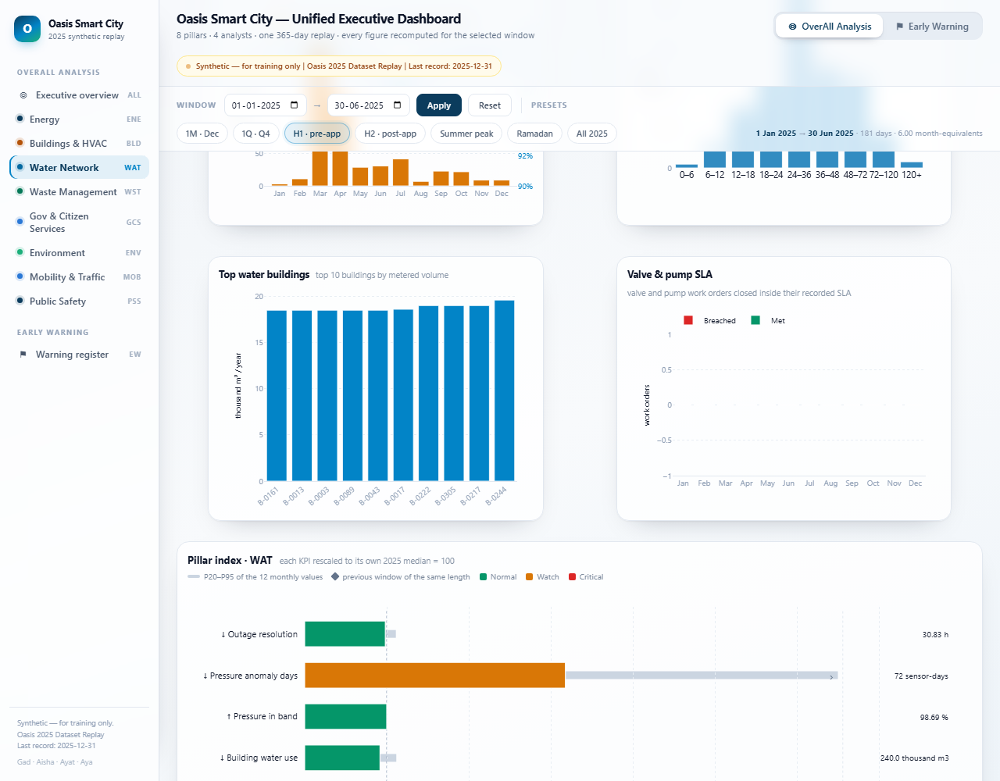

# 🏙️ UOIS: Urban Operations Intelligence System

**From citizen request to verified action: one evidence chain across eight city service pillars.**

**UOIS** (Urban Operations Intelligence System) is an integrated smart-city platform for the Oasis District. It was built during an AI & Data Analysis training program at the **Administrative Capital for Urban Development (ACUD)**, Oct–Nov 2026. It turns citizen complaints and city operations data into comparable pillar KPIs, validated early warnings, AI-classified service requests, complaint forecasts and "what-if" decision simulations.

> ⚠️ **All data is synthetic** and was generated with AI for training purposes. It contains no real ACUD or citizen data.

🔗 **Live demo:** _coming soon_



---

## ✨ Features

| Module | What it does |
|---|---|
| 🗺️ **City Map** | An interactive map of the district's six zones, showing service requests, service centres and operational layers |
| 📊 **Executive Dashboard** | KPI cards for 8 pillars (Water, Waste, Environment, Energy, Buildings & Facilities, Mobility & Traffic, Public Safety, Government & Citizen Services), built on one shared standard |
| 🤖 **AI Complaint Classifier** | A fine-tuned **MARBERTv2** (BERT) model that classifies Arabic, Franco-Arabic and English complaints into 16 categories: **96.8% accuracy, 0.968 macro-F1** |
| 🔒 **PII Sanitization** | Masks national IDs, phone numbers, cards and emails before a complaint is stored |
| 📈 **Complaints Forecast** | **LightGBM** models forecast daily complaints per zone and category, with 80% confidence bands |
| 🧪 **Decision Lab** | A 60-day simulator that answers "what if we fix one problem in one zone?" and ranks the 10 best interventions |
| ⚠️ **Early Warning** | Sensor-first warnings (for example, a water pressure drop), confirmed by independent evidence before an alert is raised |
| ✅ **Verification Engine** | Separates genuine physical faults (true alarms) from unconfirmed or debunked alerts (false alarms) |
| 💰 **Cost of Delay Engine** | Turns open faults and losses into cost and risk per pillar, with repair-time scenarios and a 0–100 risk index |

## 🏗️ Architecture

```
Citizen portal ──► Flask API (citizen_app.py) ──► BERT classifier ──► service_requests.csv
                        │
                        ├── /api/forecast, /api/simulate ──► LightGBM forecasts + 60-day simulator
                        ├── /api/ew/*                    ──► Early-warning ML model
                        ├── /api/cost/*                  ──► Cost Engine
                        └── /dashboard                   ──► oasis_city_system.html (UOIS UI)
```

## 🛠️ Tech Stack

- **Backend:** Python, Flask
- **AI/ML:** PyTorch, Hugging Face Transformers (MARBERTv2), LightGBM, scikit-learn, SciPy
- **Data:** Pandas, NumPy
- **Frontend:** HTML, CSS, JavaScript, Plotly, Mapbox GL
- **Testing:** pytest

## 🚀 Getting Started

### Option 1: Dashboard only (no Python needed)
Open `oasis_city_system.html` or `Output/dash_1.html` in any modern browser.

### Option 2: Full platform with the AI services
```bash
python -m venv .venv
.venv\Scripts\activate          # Windows  (Linux/macOS: source .venv/bin/activate)
pip install -r requirements.txt
python citizen_app.py
```
Then open:
- UOIS dashboard: http://127.0.0.1:5000/dashboard
- Citizen portal: http://127.0.0.1:5000/portal
- Forecast: http://127.0.0.1:5000/forecast

On Windows you can double-click `run_oasis.bat` instead.

> **Note:** The fine-tuned BERT weights (`model.safetensors`, 326 MB) and the full sensor datasets are not included because they exceed GitHub's file-size limit. Without the weights, the classifier endpoints report `model_not_loaded`. Every other module still works.

### Run the tests
```bash
python -m pytest tests -q
```

## 📁 Project Structure

```
├── citizen_app.py            # Flask server, citizen portal and REST API
├── oasis_city_system.html    # UOIS dashboard (city map, pillars, warnings, Decision Lab)
├── Output/dash_1.html        # Executive dashboard and complaints forecast (standalone)
├── simulator_service.py      # Decision Lab API (60-day simulator)
├── cost_engine.py            # Cost Engine
├── verification_service.py   # Verification Engine
├── oasis_franco.py           # Franco-Arabic text normalisation for the classifier
├── Moamen/                   # BERT classifier: notebooks, config and tokenizer
├── Ayat/                     # LightGBM forecasting and 60-day simulator
├── Datasets/                 # Synthetic city datasets (sample)
├── tests/                    # pytest suite
└── docs/                     # Integration plan, Decision Lab plan and report
```

## 👥 Team

This project was built by a team of trainees in the ACUD AI & Data Analysis training program.

| Member | Contribution |
|---|---|
| **Aisha Alsadani** ([@aishaalsadani](https://github.com/aishaalsadani)) | City Map, system integration (connecting the models, APIs and dashboards into one platform), and UI styling |
| Moamen | BERT complaint classifier |
| Ayat | Complaints forecasting and 60-day simulator |
| Aya | Early-warning analysis |

---

*Synthetic data, for training purposes only. No real-city results or savings are claimed.*
